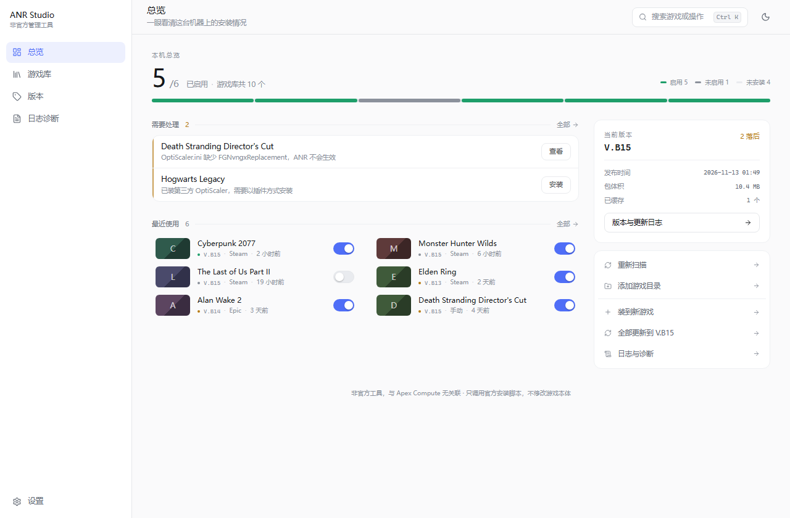
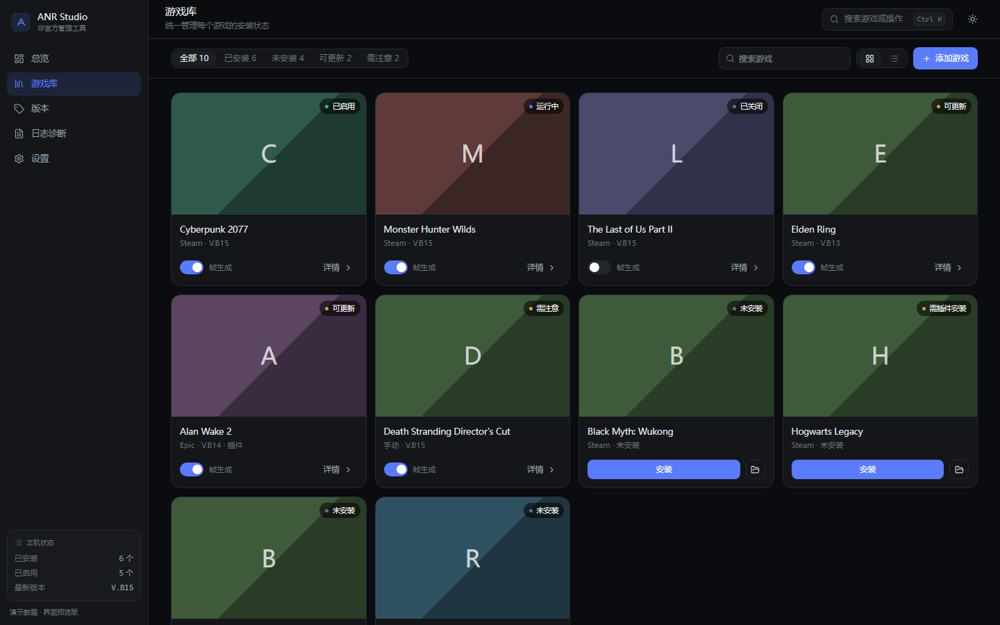
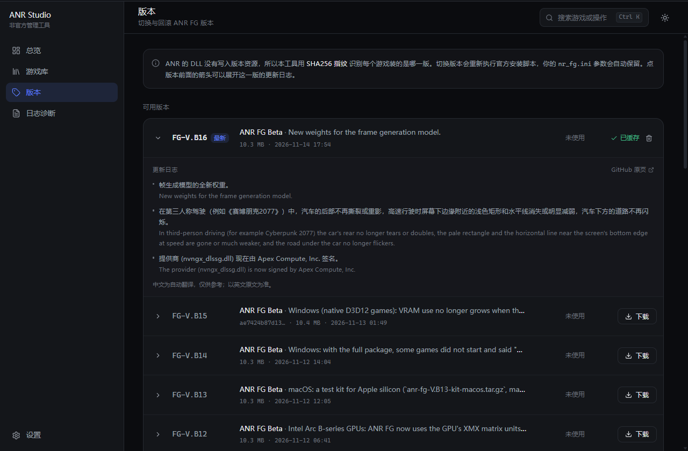
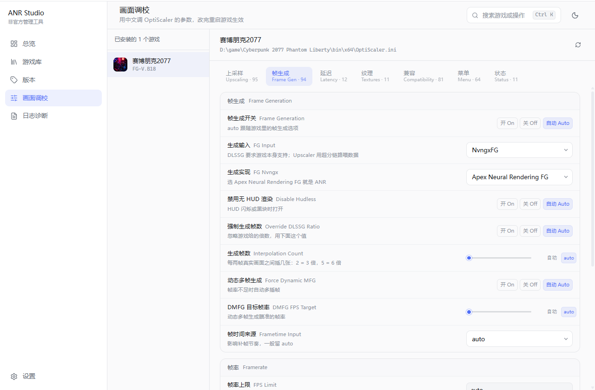
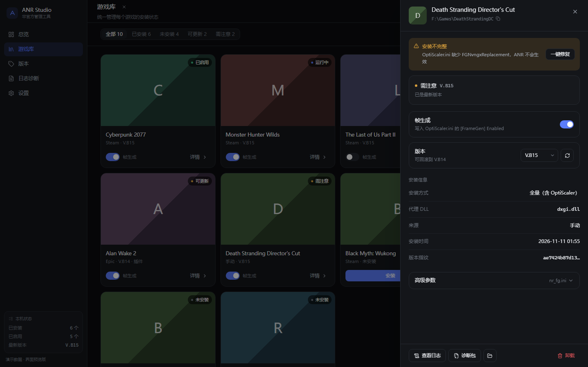
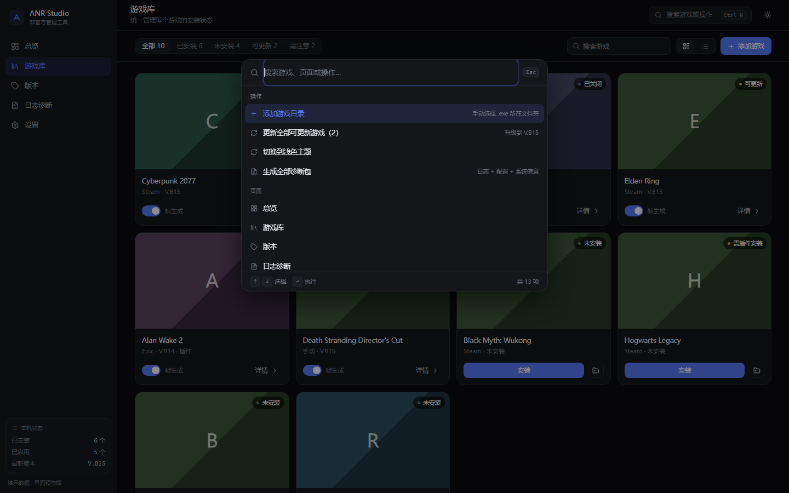
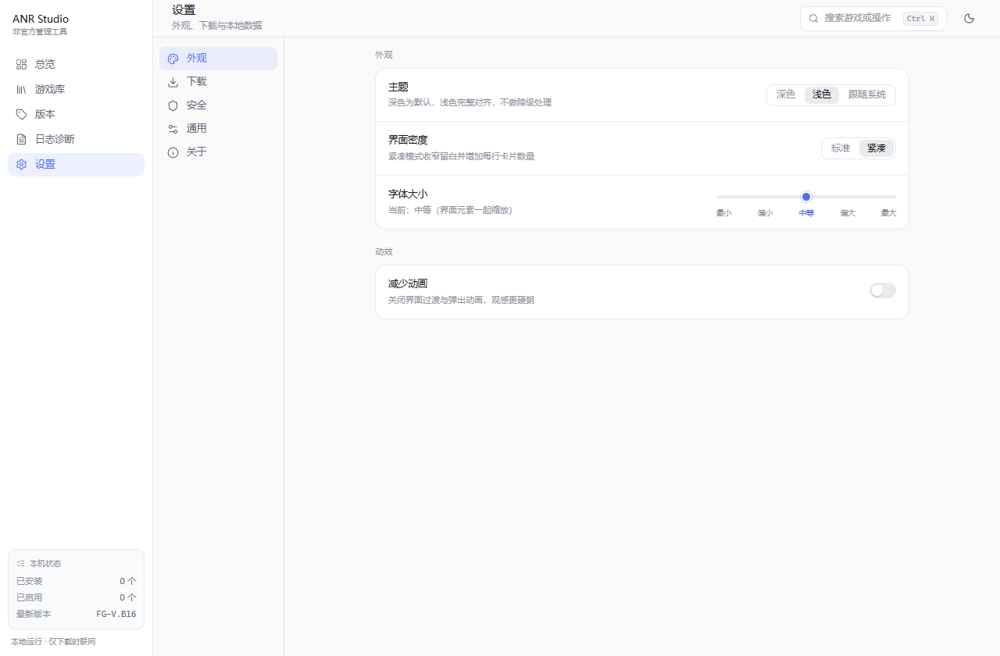
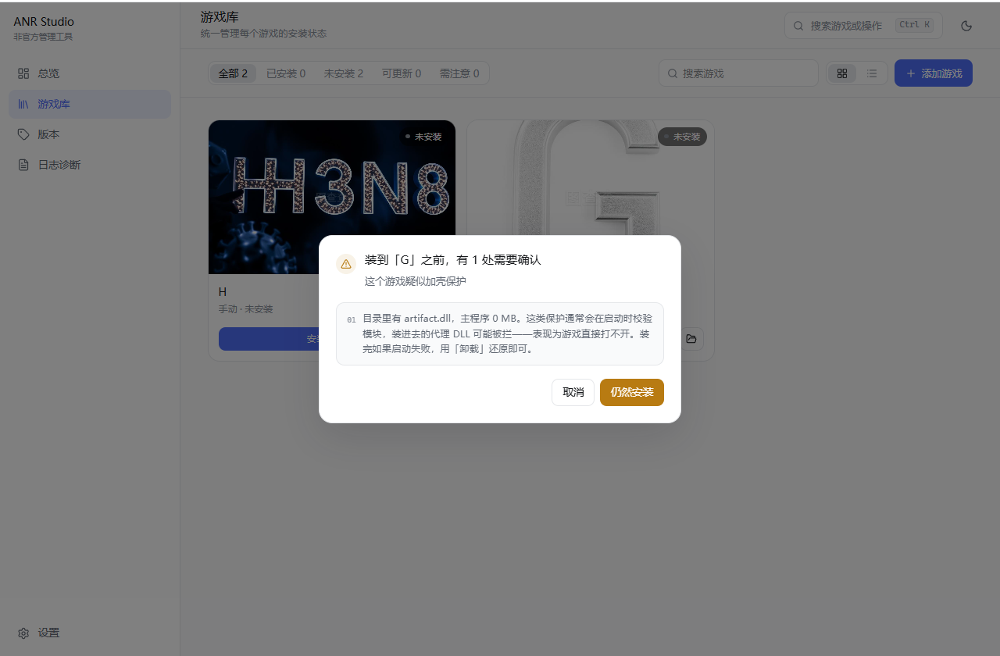
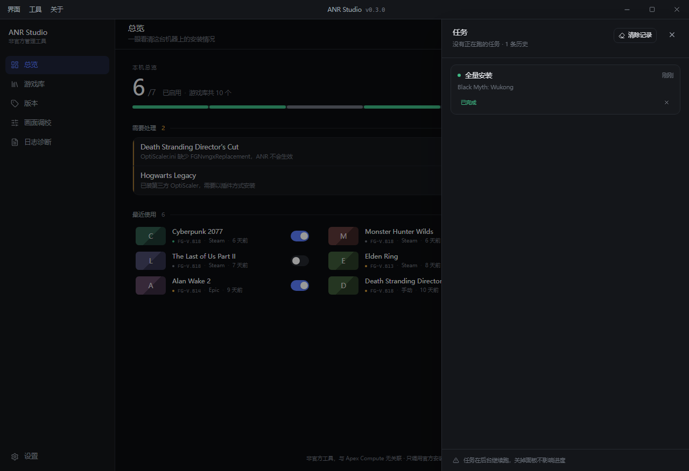

# ANR Studio

[](https://github.com/Utmotc/ANR-Studio/releases/latest)
[](LICENSE)
[](https://github.com/Utmotc/ANR-Studio/releases/latest)
[](https://tauri.app/)

ANR（Apex Neural Rendering）的非官方图形化管理工具。把「跑命令行安装器 + 记不清装了哪个版本」变成一张看得见的状态表。

启动后自动扫出 Steam / Epic / GOG 里的游戏，一眼看清装了哪些、开的哪一档、要不要更新，装/卸/切版本/调参数都在界面里完成。

> **非官方项目，与 Apex Compute 无关联。** 不修改游戏本体，不注入内存，不联网上传任何数据，只调用官方 `install.ps1` 并读写配置文件。
>
> 官方项目：[apex-compute/ANR](https://github.com/apex-compute/ANR) ｜ 底层注入层：[OptiScaler](https://github.com/optiscaler/OptiScaler)

## 下载

到 [Releases](https://github.com/Utmotc/ANR-Studio/releases/latest) 下载 `ANR Studio_x.y.z_x64-setup.exe`，双击安装即可。

- 仅支持 **Windows 10 / 11 x64**
- v0.4.0 起应用内可以检查并安装更新，更新包会**验签**（minisign，公钥内置）
- 安装包是否带 Authenticode 签名取决于发布时是否配置了证书；未配置时首次运行仍会被 SmartScreen 拦一下：点「更多信息」→「仍要运行」
- 需要已安装 **VC++ 运行库**（x64），游戏侧还需要官方 ANR 支持的显卡环境

## 更新（v0.4）

设置 → 关于里可以选三种模式：

| 模式 | 行为 |
|---|---|
| 自动 | 启动 3 秒后检查，有新版直接下载并覆盖安装，完成后提示重启 |
| 仅提示（默认） | 静默检查，有新版在「关于」里显示，由你点「更新到 x.y.z」 |
| 关闭 | 完全不检查 |

更新包下载后会先验签，验签失败不会安装；断网时静默失败，不弹错误框。设置里的「下载源 = 镜像」同样作用于更新检查（走 `gh-proxy`）。

## 安装与卸载

- 默认安装目录是 **`%LOCALAPPDATA%\ANR Studio`**，属于当前用户，安装和卸载都**不需要管理员权限**。
- 安装向导里可以改目录。如果改到受保护的位置（例如需要管理员才能写的 `D:\SoftWare`），安装和卸载都会要求管理员权限；安装包检测到目录不可写时会先提示，建议退回默认目录。
- 卸载不需要手动退出应用：卸载程序会先结束 `anr-studio.exe`（含托盘里、以及以管理员身份启动的进程）。普通权限处理不了时会请求一次管理员权限继续卸载，而不是让「点了卸载没反应」。
- v0.4.0 的更新源指向 GitHub Releases 的 `latest.json`。在该文件上传之前，检查更新会显示「还没有可用的更新信息」，这是预期行为，不影响使用。

## 界面

界面截图使用演示数据，与真实安装状态无关。

| 总览 | 游戏库 |
|---|---|
|  |  |

| 版本切换 | 画面调校 |
|---|---|
|  |  |

| 游戏详情抽屉 | 命令面板 |
|---|---|
|  |  |

| 设置 | 安装前检查 |
|---|---|
|  |  |

任务中心（0.3.0）：安装、卸载、切换版本、预下载都在这里排队，失败原因可展开，失败可直接重试。



## 已实现

- **游戏发现**：Steam（注册表 + `libraryfolders.vdf` + `appmanifest_*.acf`）、Epic（Manifests）、GOG（注册表）、手动添加
- **状态识别**：`nr_fg_install.json` → 安装方式（full/addon）、代理 DLL、安装时间；`nvngx_dlssg.dll` 的 SHA256 → 版本
- **安装**：下载官方包 → 校验 SHA256SUMS → 解压到缓存 → 执行官方 `install.ps1` → 后置校验
- **自动判型**：目录里已有第三方 OptiScaler 时自动改用 addon 包，不覆盖用户配置
- **开关**：写 `OptiScaler.ini [FrameGen] Enabled`（原子写，保留 BOM/CRLF）
- **参数**：`nr_fg.ini` 的卷积路径、最大生成帧、场景切换保护、HDR 亮度
- **版本切换 / 回滚**：覆盖安装，`nr_fg.ini` 自动保留
- **卸载**：full 按哈希校验还原 `dxgi.dll` 与 `OptiScaler.ini` 并删除 OptiScaler 目录；addon 只移除 ANR 目录并把 ini 恢复成安装前的值
- **安全前置**：游戏运行中阻断、VC++ 运行时提示、卸载前自动快照（可在设置里关闭）
- **快照恢复**：快照包含 `OptiScaler/`、代理 DLL 与 `OptiScaler.ini`；抽屉里可列出并恢复，旧快照仍兼容但会标「旧版」
- **失败闭环**：安装/切换失败弹窗提供「重试 / 生成诊断包 / 回滚到快照」，并展示安装器原始输出
- **任务中心**：安装 / 卸载 / 切换 / 预下载全部进任务队列，右上角有计数入口（`Ctrl+Shift+J`），可看历史、进度、失败原因，失败可直接重试
- **批量操作**：多选后一次确认、顺序执行，批量安装 / 批量卸载 / 批量开关 / 批量更新到最新，结束后给「成功 N、失败 M」汇总
- **运行状态实时化**：每 5 秒检查一次进程与代理 DLL 占用；所有写操作（安装 / 卸载 / 切换 / 开关 / 调参 / 修复）执行前后都会实时复查，游戏运行时直接拒绝
- **安装体检**：检查 provider 文件、代理 DLL、OptiScaler.ini 关键项与安装记录，能本地修的（写回 `FGNvngxReplacement`、从备份还原 DLL/ini）一键修复，修不了的明确提示重装
- **安装脚本保护**：`-NonInteractive` + stdin 断开，脚本不会再卡在交互提示；10 分钟超时与取消都会终止进程并回滚
- **日志与诊断**：读最新 `nr_fg-*.log`、一键打包（日志 + 两个 ini + 安装记录 + 系统信息）
- **日志实时跟随（0.4）**：每秒增量读取（单次 256 KB，不再整份读进内存），滚到底部自动跟随、上滚暂停；切到别的页面或窗口隐藏时停轮询
- **崩溃捕获（0.4）**：后端 panic hook + 前端 ErrorBoundary / `window.onerror` 落盘到 `crash/`，下次启动提示，可一键生成崩溃诊断包；前端不再白屏
- **诊断包升级（0.4）**：新增 GPU 型号 / 驱动版本 / 显存 / CPU / 内存 / 游戏 exe 版本，文本自动脱敏（用户名路径、SteamID64），附 `manifest.json`（sha256 清单）
- **代理 DLL 手动覆盖（0.4）**：`dxgi` / `winmm` / `version` 三选一，切换前快照、切换后校验 `nr_fg_install.json`，失败回滚
- **自动更新（0.4）**：应用内检查 / 下载 / 覆盖安装，更新包验签，支持镜像线路与三档检查模式
- **单实例（0.4）**：重复启动只保留一个窗口，第二个进程直接退出并聚焦已有窗口
- **安全加固（0.4）**：收紧 CSP；外链改用 `ShellExecuteW`，不再拼 `cmd /C start`

## 界面细节

- **自绘标题栏**：关闭系统装饰（`decorations: false`），自绘 36px 标题栏 —— 左侧是「界面 / 工具 / 关于」多级菜单（主题、密度、字体大小、重新扫描、打开数据目录都能两级点到位），中间是应用名与版本号，右侧是任务中心 / 语言 / 主题 / 最小化 / 最大化（还原）/ 关闭
- **界面密度**：标准 / 紧凑。紧凑模式收窄留白、卡片内边距、导航与顶栏高度，卡片最小宽度 228px → 184px，同一行多放一个
- **总览页**：不看统计卡，直接给「已启用 x/y + 一条状态带（每个已装游戏一段色块）」；左栏是需要处理与最近使用，右栏是当前版本与快捷操作
- **游戏改名**：右键卡片 →「修改游戏名」，名字只影响显示与封面搜索，不动游戏文件
- **字体大小**：设置里五档滑杆（最小 / 偏小 / 中等 / 偏大 / 最大），整界面等比缩放
- **设置页**：居中悬浮弹窗，固定高度、内容区独立滚动；左侧独立分类导航（外观 / 下载 / 安全 / 通用 / 关于），不和主导航混在一起
- **更新日志**：版本列表每行前面的箭头可展开这一版的说明，中文译文在上、英文原文在下；中文由自动翻译生成并按版本缓存到本地，取不到就显示空
- **游戏封面**：来源可在设置里选「自动 / 国内 / 国外」。国外走 Steam（失败回落 GOG），中文名用中文索引查；国内走 360 图片（image.so.com），要求结果标题里出现游戏名，避免配错游戏。自动模式先探测国外是否可达，不可达就直接用国内。右键还可以「选择本地图片作封面」
- **系统托盘**：关闭窗口时弹窗询问「最小化到托盘 / 直接退出」，可勾选记住选择；托盘左键显示窗口，右键菜单可显示或退出。设置 → 通用 → 关闭窗口时可随时改回每次询问
- **深浅主题**：两套 token 完全对齐，标题栏与控制按钮同步跟随
- 弹出层（抽屉 / 命令面板 / 弹窗）从标题栏下方开始，标题栏始终可点

## 技术栈

| 层 | 选型 |
|---|---|
| 外壳 | Tauri 2（Rust） |
| 界面 | React 19 + TypeScript + Tailwind 4 + Zustand + lucide |
| 打包 | 单文件前端产物（vite-plugin-singlefile）+ NSIS 安装包 |
| 网络 | reqwest（rustls）访问 GitHub Releases |
| 加密 | sha2 做包校验与版本指纹 |

## 开发 / 构建

```bash
cd app
npm install
npm run dev          # 浏览器预览（走演示数据）
npm run tauri dev    # 真桌面应用（走真实后端）
npm run tauri build  # 出安装包：src-tauri/target/release/bundle/nsis/
```

Rust 侧可在 `app/src-tauri/` 单独检查：

```bash
cd app/src-tauri && cargo check
cargo test --lib
```

同一套命令在 CI 里跑（`.github/workflows/ci.yml`）：`tsc --noEmit` + `vite build` + `cargo test --lib`。

## 发布（维护者）

1. **更新签名密钥**（只做一次）：`tauri signer generate` 生成 minisign 密钥对，公钥写进 `app/src-tauri/tauri.conf.json → plugins.updater.pubkey`；私钥与密码放进 GitHub secrets：
   - `TAURI_SIGNING_PRIVATE_KEY`
   - `TAURI_SIGNING_PRIVATE_KEY_PASSWORD`
2. **可选 Authenticode**：把 PFX 转 base64 放进 `WINDOWS_CERT_PFX_BASE64` + `WINDOWS_CERT_PASSWORD`（或用 `WINDOWS_CERT_THUMBPRINT`）。配置后 CI 会生成绝对路径的 `signCommand` 覆盖配置，主程序与安装包都会用 RFC3161 时间戳签名；没有证书时只出未签名包，本地构建不受影响。
3. 推 `v0.4.0` 这样的 tag（或手动触发 `release` workflow），CI 产出草稿 Release：NSIS 安装包、`.sig`、`latest.json`、`SHA256SUMS.txt`。检查后手动发布草稿，客户端就能检测到更新。

> 本地调试更新链路时，用 `TAURI_SIGNING_PRIVATE_KEY` 指向 `.tauri-keys/anr-studio.key` 再 `tauri build`；密钥目录已 gitignore，不要提交。
>
> 注意：`bundle.createUpdaterArtifacts = true`，所以**打包**会要求更新签名私钥；只想要一个不带 `.sig` 的安装包时，可以临时用
> `npm run tauri build -- --config "{\"bundle\":{\"createUpdaterArtifacts\":false}}"`（命令行 JSON 里的引号在 PowerShell 下需要转义）。

## 数据位置

全部在 `%LOCALAPPDATA%\app.anrstudio.desktop\anr-studio\`：

| 路径 | 内容 |
|---|---|
| `settings.json` | 主题、下载源、缓存目录、手动添加的游戏、更新模式 |
| `catalog.json` | 版本指纹表（provider DLL 的 SHA256 → 版本标签） |
| `cache/<tag>/<kind>/` | 解压好的官方安装包，跨游戏复用 |
| `snapshots/` | 卸载前的 OptiScaler 目录快照（zip） |
| `crash/` | 崩溃报告（`.txt`）与已处理标记（`.ack`） |
| `diag/` | 生成的诊断包（含 `manifest.json`：文件 sha256、脱敏规则版本） |

## 目录

```
ANR-Studio/
├─ app/                     应用源码
│  ├─ src/                    前端
│  │  ├─ components/          GameCard、Drawer、CommandPalette、TaskCenter、Overlays、ui
│  │  │                       ErrorBoundary / CrashNotice（0.4）
│  │  ├─ views/               Overview / Library / Versions / Tuning / Logs / Settings
│  │  ├─ lib/ipc.ts           Tauri 调用封装（浏览器里自动回退到演示数据）
│  │  ├─ lib/focus.ts         弹层焦点陷阱
│  │  ├─ i18n/                运行时字典（简体中文 / English）
│  │  ├─ store.ts             状态与动作（Zustand）
│  │  └─ index.css            设计 token（深浅两套 + 密度变量）
│  ├─ src-tauri/src/
│  │  ├─ lib.rs               Tauri 命令层（扫描/安装/卸载/开关/日志/封面/诊断/更新）
│  │  ├─ scan.rs              Steam / Epic / GOG / 手动 + exe 判定 + 进程检测
│  │  ├─ inspect.rs           安装状态与配置解析、SHA256 指纹（带缓存）
│  │  ├─ installer.rs         下载、校验、解压、调官方脚本、快照、卸载还原
│  │  ├─ health.rs            安装体检与一键修复
│  │  ├─ covers.rs            封面搜索与缓存（Steam 商店 → GOG 回落）
│  │  ├─ releases.rs          GitHub Releases + SHA256SUMS + 镜像前缀
│  │  ├─ crash.rs             崩溃捕获（panic hook / 前端异常 / ack）
│  │  ├─ sysinfo.rs           GPU/驱动/CPU/内存采集与脱敏
│  │  ├─ ini.rs               ini 原子读写（保留 BOM/换行风格/行内注释）
│  │  ├─ logs.rs              增量日志读取与诊断包（含 manifest）
│  │  ├─ changelog.rs         release 正文解析 + 中文翻译缓存
│  │  └─ model.rs paths.rs    数据结构与本地存储
│  └─ scripts/                开发辅助：CDP 截图、窗口截图、i18n、签名
├─ .github/
│  ├─ workflows/              ci.yml / release.yml（0.4）
│  └─ scripts/sign-windows.ps1 Authenticode 签名入口（0.4）
├─ docs/
│  ├─ ANR-Studio-设计文档.md   完整设计文档
│  ├─ ANR-Studio-v0.4-计划.md  v0.4 规划
│  └─ screenshots/            界面截图（演示数据）
├─ .gitignore
├─ LICENSE
└─ README.md
```

## 网络

所有 HTTP 请求统一走 `app/src-tauri/src/net.rs`：先读 `HTTPS_PROXY` / `HTTP_PROXY` / `ALL_PROXY` 环境变量，再读 Windows 的 Internet 设置（`ProxyEnable` / `ProxyServer`）。国内用户开着 Clash 之类的系统代理时，应用会自动跟着走，不需要额外配置。

下载源支持「直连 / 镜像」，这个设置同时作用于版本列表和安装包下载：直连真的不吃代理，镜像走 `gh-proxy.com` 前缀。调试构建可以用 `ANR_STEAM_BASE` / `ANR_STEAM_CDN` 把商店地址指到本地假服务器（`app/scripts/mock_steam.py`），用于离线验证封面链路；release 构建忽略这两个变量。

## 已知限制

- 仅 Windows（Linux/Proton 需要改 Steam 启动项，未实现）
- 版本指纹表只内置了已确认的版本；下载过新版本后会自动补全，未命中显示「未知」
- 镜像加速用的是第三方代理（`gh-proxy.com`），需在设置里手动选择
- 反作弊游戏未做名单判断，安装前只给通用提示
- 安装包是否签名取决于发布时是否配置 Authenticode 证书；未配置时 SmartScreen 仍会提示「未知发布者」
- 帧数 / 延迟统计暂未包含（需要一份真实 `nr_fg-*.log` 样本才能写解析器），日志页只展示原文

## 声明

- 「ANR」「Apex Neural Rendering」及相关资源归 Apex Compute 所有
- 「OptiScaler」归其作者所有
- 本项目与上述组织/作者无隶属或背书关系，仅提供安装与配置的图形化外壳
- 使用本工具产生的一切后果由使用者自行承担，请遵守游戏服务条款

## 许可证

[MIT](LICENSE) © 2026 Utmotc